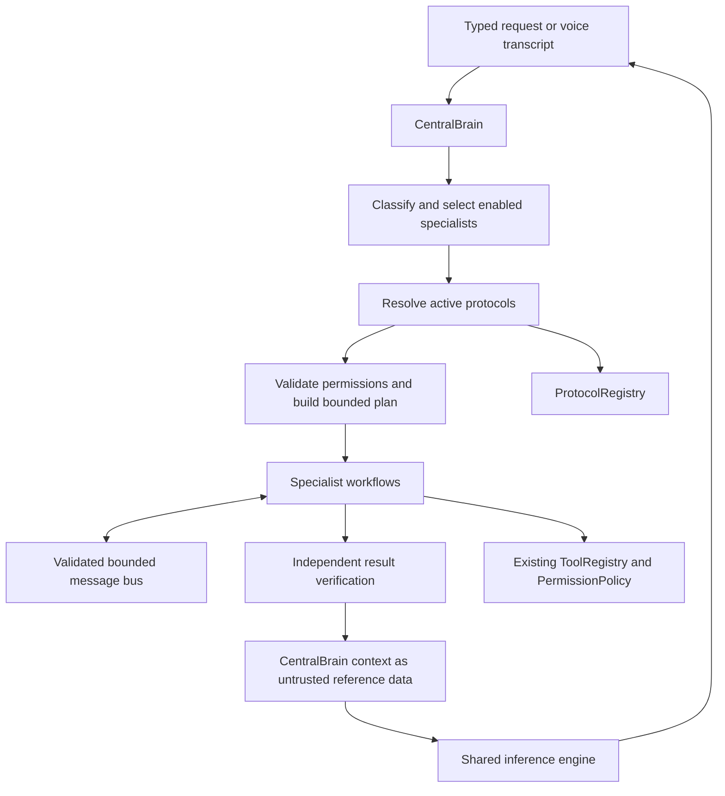

# Agent architecture

## Authority and data flow

`CentralBrain` remains the only conversation authority. It uses the bounded specialist orchestrator when a request matches an enabled capability, and then asks the existing `ConversationEngine` and shared inference provider to synthesize one user-facing answer.

## Common contracts

`AgentSpec` defines identity, version, description, capabilities, required permission levels, and a tool allowlist. `AgentTask` carries root request identity, dependencies, bounded context, and lifecycle status. `AgentResult` contains task/agent identity, status, summary, findings, evidence, actions, errors, warnings, confidence, protocol versions, and verification status. `AgentMessage` validates sender/recipient IDs, message kind, required payload fields, size, and context reference count.

The registry contains nine specialists and supports discovery, enable/disable, and only-narrower tool configuration. Workflows receive at most two recent turns, five relevant memory excerpts, the applicable protocol summaries, dependency results, and a tool invocation callback. They do not receive a conversation database or unrestricted filesystem access.

## Safety and limits

Agent tools are invoked through the existing registry with an `agent:<id>` audit identity. The orchestrator rechecks policy and the specialist allowlist before execution. Message and task counts, context size, task timeout, global workflow concurrency, and active root runs are bounded. Agents can request information only from an already authorized sibling; this does not create additional work. Dependency validation rejects missing nodes and cycles. Cancellation is cooperative.

Results are checked independently for identity, status and structure, missing evidence, and contradictory findings. This is structural verification, not a proof that every claim is true. Protocol versions are recorded. Compliance remains partial without procedure-level evidence. Final synthesis treats specialist output as reference data, not instructions.

Specialist workflows are currently deterministic and limited. There are no nine model instances and no agent-owned conversational loops. The shared language model is used only by the existing final response path when configured.
