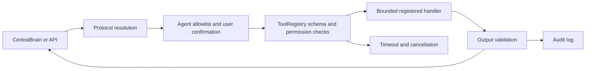

# Tool architecture (Phase 7)

## One execution boundary

All registered actions run through `backend/tools/registry.py`. `ToolSpec` defines an ID/name, description, input/output schemas, permission level, risk, version, timeout, availability, confirmation requirement, and handler. The registry validates bounded JSON arguments and results, checks `PermissionPolicy`, applies a bounded worker pool, cooperatively observes cancellation, reports timeouts, and writes audit events. A timed-out non-cooperative Python handler retains its worker slot until it exits.

Agents receive only their registry-declared tool capabilities and invoke through a callback that rechecks agent allowlist and permission policy. The API tool endpoint also resolves relevant active protocols before execution. Scheduled system snapshots resolve protocols and use the same registry. Retrieved documents and web/MCP results are untrusted reference data.

## Configuration and defaults

`AEGIS_ALLOWED_TOOLS` replaces the default tool allowlist if set. `AEGIS_MAX_PERMISSION` sets `READ_ONLY`, `WRITE_LOCAL`, `NETWORK`, `DESTRUCTIVE`, or `PRIVILEGED`; the default is `READ_ONLY`. `AEGIS_ALLOW_NETWORK=1` is separately required for network tools. A destructive tool must be allowlisted and explicitly confirmed; HTTP confirmation is accepted only from a loopback client. Network access cannot be enabled by a tool or agent.

Tool discovery is available at `GET /api/tools`; execution uses `POST /api/tools/{tool_id}` with `{"arguments":{...},"intent":"user goal","request_id":"optional-id","confirmed":true}` when confirmation is required. A caller-supplied request ID can be cancelled during execution with `POST /api/tools/runs/{request_id}/cancel` from loopback. The registry rejects unknown fields for built-in strict schemas, caps arguments at 64 KB and results at 256 KB, and limits concurrency to four workers (two by default).

Only implemented capabilities are advertised as available. See [FILE_SYSTEM_TOOLS.md](FILE_SYSTEM_TOOLS.md), [CODE_EXECUTION.md](CODE_EXECUTION.md), [WEB_RESEARCH.md](WEB_RESEARCH.md), [MCP_INTEGRATION.md](MCP_INTEGRATION.md), and [DEVICE_INTEGRATION.md](DEVICE_INTEGRATION.md).
